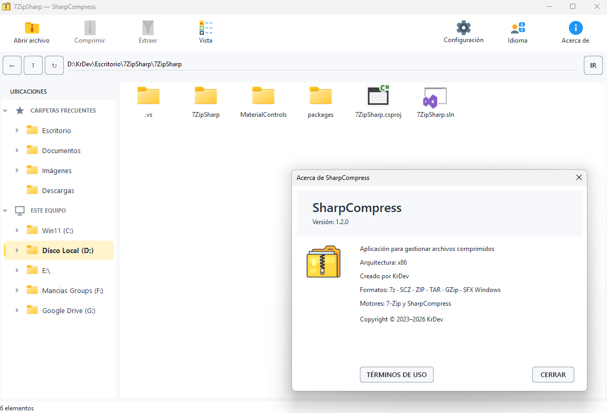

# SharpCompress



SharpCompress es un administrador de archivos comprimidos para Windows. Permite explorar carpetas y archivos, crear y extraer archivos comprimidos, revisar su integridad e integrarse con el Explorador de Windows. La aplicación usa Windows Forms y requiere .NET Framework 4.7.2 o posterior.

[Descargar SharpCompress 1.2.1](https://github.com/KrDev0/SharpCompress/releases/download/v1.2.1/SharpCompress_Setup_1.2.1.exe) · [Ver publicaciones](https://github.com/KrDev0/SharpCompress/releases)

## Funciones

- **Explorador integrado:** navega por carpetas y archivos comprimidos, cambia entre detalles, lista, mosaicos e iconos, ordena elementos y consulta iconos del sistema.
- **Interfaz:** tema claro con controles WinForms personalizados de estilo Material, incluyendo botones, campos de texto, pestañas y listas.
- **Compresión:** crea archivos 7z, SCZ, ZIP, TAR y GZip. Acepta archivos, carpetas y selecciones mixtas conservando la estructura relativa. Incluye perfiles de velocidad/tamaño, niveles y métodos disponibles para cada formato, contraseñas y volúmenes cuando el formato lo permite.
- **Formato propio SCZ:** extensión de SharpCompress para un contenedor 7z estándar. Elígela para reconocer y distinguir los archivos creados con SharpCompress, manteniendo compatibilidad con herramientas que leen 7z. Conserva LZMA2, AES-256, encabezados cifrados, volúmenes y autoextracción. La extensión no crea un códec nuevo ni comprime más que 7z por sí sola.
- **Extracción:** extrae archivos completos o elementos seleccionados, conserva las carpetas internas, muestra el avance y permite cancelar. Para conflictos ofrece reemplazar, reemplazar todo, omitir o cancelar.
- **Verificación y propiedades:** comprueba la integridad de archivos comprimidos; calcula SHA-1 o SHA-256 y muestra propiedades de elementos desde el explorador.
- **Autoextractores:** crea ejecutables `.exe` basados en 7z y permite definir título, carpeta de destino, mensaje, modo visible/silencioso, programa posterior e icono `.ico` personalizado.
- **Menú de Windows:** instala un menú en cascada SharpCompress para archivos, carpetas y selecciones múltiples. Incluye compresión, apertura y opciones de extracción coherentes con el elemento seleccionado.
- **Aplicaciones predeterminadas:** el instalador permite seleccionar formatos para registrar SharpCompress; Windows solicita confirmar las asociaciones en su página de aplicaciones predeterminadas.
- **Preferencias y diagnóstico:** guarda idioma, vista, perfil y carpetas recientes, política de conflictos e icono del menú contextual. Incluye interfaz clara en español e inglés, reparación de la integración de Explorer y registro de errores.

El icono del programa es fijo; el icono del menú contextual y el de cada autoextractor pueden configurarse por separado. Las contraseñas no se guardan.

## Instalación

Descarga y ejecuta `SharpCompress_Setup_1.2.1.exe`. El instalador configura la integración opcional con el Explorador y registra los formatos elegidos como candidatos para abrirse con SharpCompress. Windows requiere que el usuario confirme cada asociación predeterminada desde Configuración.

## Compilación

Desde Visual Studio Developer PowerShell en la raíz del repositorio:

```powershell
msbuild .\7ZipSharp\7ZipSharp.sln /restore /p:RestorePackagesConfig=true /p:RestoreConfigFile=NuGet.Config /p:Configuration=Release
msbuild .\7ZipSharp\7ZipSharp.sln /p:Configuration=Debug
msbuild .\7ZipSharp\7ZipSharp.sln /p:Configuration=Release
dotnet test .\SevenZipSharp-dev\SevenZip.Tests\SevenZip.Tests.csproj --configuration Debug
ISCC.exe .\7ZipSharp\7ZipSharp\setup\sharpSetup.iss
```

La solución incluye la aplicación WinForms, los controles visuales y la biblioteca SevenZipSharp. Las pruebas NUnit cubren la biblioteca. El instalador requiere Inno Setup 6. `7ZipSharp/7ZipSharp/setup/sharpSetup.iss` es la definición vigente de instalación y registro; los `.reg` heredados, si aparecen en una copia anterior, no deben importarse.

## Licencias y reportes

Consulta `LICENSE.txt` y `third-party-licenses/` antes de redistribuir componentes. Para reportar un error, incluye la operación y la entrada pertinente de `%LOCALAPPDATA%\KrDev\SharpCompress\Logs\errors.log`; nunca compartas contraseñas ni archivos privados.
